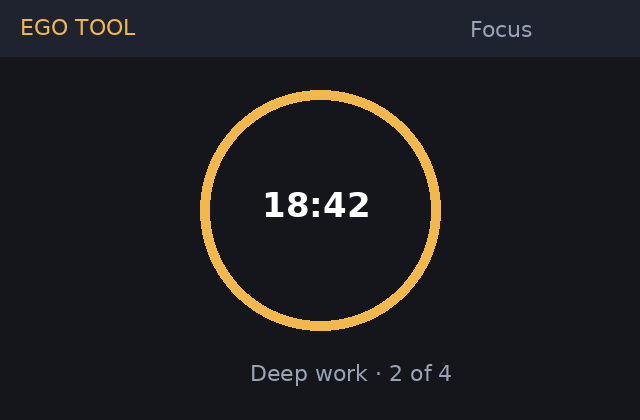
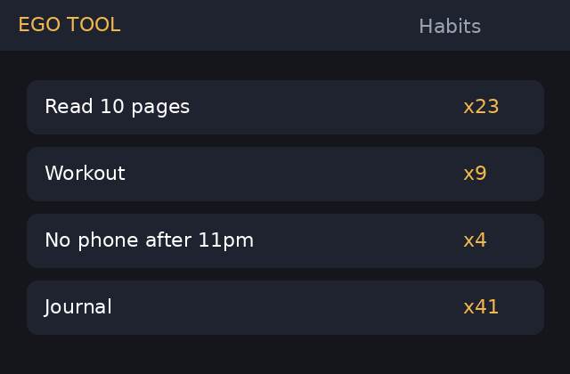
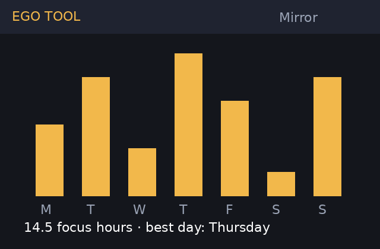

# EGO TOOL

**Focus on what matters. Build habits that stick.**

EGO TOOL is a free, open-source focus and habit tracker for Windows, macOS, Linux and Android.
It combines a focus timer, a daily habit board and honest weekly reports in one small app —
no account required, and your data stays on your device unless you turn on sync.

> Current version: **v1.4.0** (October 2026) · [Changelog](CHANGELOG.md) · [FAQ](docs/FAQ.md)

---

## ✨ Features

| | Feature | What it does |
|---|---|---|
| ⏱️ | **Focus Sessions** | Pomodoro-style timer (25/5 by default, fully customizable) with optional site/app blocking on desktop |
| ✅ | **Habit Board** | Daily and weekly habits with streaks, skip days and "minimum version" goals (e.g. *read 1 page*) |
| 📊 | **Weekly Mirror** | A plain-language weekly report: focus hours, best days, broken streaks and one suggestion |
| 🎯 | **Ego Check** | A 30-second evening check-in: *Did I do what I said I would?* Builds a personal honesty score |
| 🔥 | **Streak Shields** | Earn a shield every 7-day streak that protects one missed day |
| 👥 | **Accountability Pods** *(beta)* | Join a small group of 3–5 people who see each other's streaks (not details) |
| 🌙 | **Themes** | Light, Dark, and "Deep Focus" (minimal grey) |
| 🔒 | **Local-first** | Everything is stored on your device. Optional end-to-end encrypted sync (EGO Sync) |
| 🌍 | **Languages** | English, Português, Español, हिन्दी, বাংলা (community translations welcome) |

## 📸 Screenshots

| Focus timer | Habit board | Weekly Mirror |
|---|---|---|
|  |  |  |

## ⬇️ Download

| Platform | Link | Notes |
|---|---|---|
| Windows 10/11 | [EGO-TOOL-Setup-1.4.0.exe](https://github.com/dhruv25956-hue/ego-tool/releases/latest) | Installer, auto-updates |
| macOS 12+ | [EGO-TOOL-1.4.0.dmg](https://github.com/dhruv25956-hue/ego-tool/releases/latest) | Universal (Intel + Apple Silicon) |
| Linux | [AppImage / .deb](https://github.com/dhruv25956-hue/ego-tool/releases/latest) | Tested on Ubuntu 22.04+ and Fedora 39+ |
| Android 9+ | Google Play — *coming soon* · [APK](https://github.com/dhruv25956-hue/ego-tool/releases/latest) | Beta |
| iOS | — | On the roadmap (see below) |

New here? Read **[Getting Started](docs/GETTING-STARTED.md)** — it takes 3 minutes.

## 🗺️ Roadmap

| Status | Item | Target |
|---|---|---|
| ✅ Done | Habit Board v2 with skip days | v1.3 |
| ✅ Done | Weekly Mirror reports | v1.4 |
| 🚧 In progress | Accountability Pods (public release) | v1.5 — Dec 2026 |
| 🚧 In progress | Google Play release | Dec 2026 |
| 📝 Planned | iOS app | Q1 2027 |
| 📝 Planned | Calendar integration (Google / Outlook) | Q1 2027 |
| 💭 Considering | Focus music / ambient sounds | — |
| 💭 Considering | Shared team challenges | — |

Vote on what comes next in our community (see below) or open a [feature request](../../issues/new?template=feature_request.md).

## 💬 Community

We're building our official **Discord server** — the place for help, feedback, beta testing,
accountability pods and weekly focus challenges. Link coming soon.

- 🐛 Bugs → [GitHub Issues](../../issues)
- 💡 Ideas → [Feature requests](../../issues/new?template=feature_request.md)
- 📜 Rules → [Community Guidelines](docs/COMMUNITY.md)
- 🤝 Help build EGO TOOL → [Contributing](CONTRIBUTING.md)
- 🆘 Support → [SUPPORT.md](SUPPORT.md)

## 🧑‍🤝‍🧑 Team

| Name | Role |
|---|---|
| Dhruv | Founder · product & community |
| Aisha R. | Design |
| Marco T. | Desktop app |
| Priya S. | Android app |
| Community volunteers | Translations, testing, moderation |

## 📄 License

MIT — free to use, share and modify. See [LICENSE](LICENSE).

*EGO TOOL is not about ego. It's about keeping the promises you make to yourself.*
